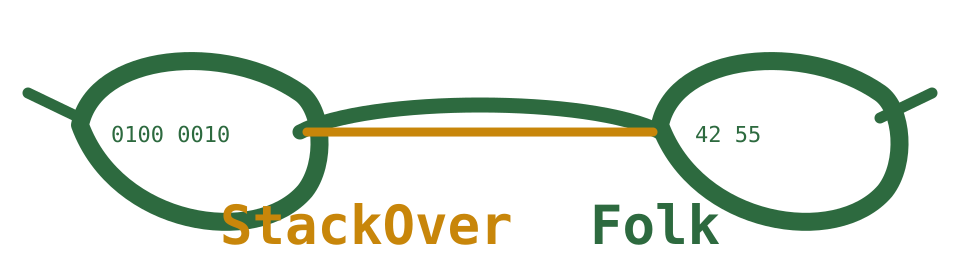

# StackOverFolk



StackOverFolk is an interactive terminal lab for learning number conversion and cryptography. It computes real results while showing a compact, navigable journey through each meaningful transformation.

## Labs

- Base 2/8/10/16 and strict seven-bit ASCII conversion
- SHA-256 and SHA-512 hashing
- DES-CBC and three-key 3DES-EDE-CBC with PKCS#7 padding (legacy education only)
- P-256 hybrid encryption: ECDH, HKDF-SHA256, and AES-256-GCM

The application opens on a flat Home menu. Use the arrow keys and Enter, or press `1` through `9` to open a lab directly. DES and 3DES are obsolete and must not be used to protect real secrets.

## Run

Node.js 22 or newer is required.

```sh
npm install
npm start
```

The logo remains visible in every lab, animates for about 2.5 seconds, and starts another cycle every 5 seconds. Use `npm start -- --no-animation` for the unchanged static logo. Non-interactive terminals and `CI=true` also print the static banner. Set `STACKOVERFOLK_REDUCED_MOTION=1` for a short reveal.

## Controls

Enter a value in the persistent input line, then press Enter. The selected lab and its settings stay active for the next value.

- `Tab` reuses the latest result as the next input.
- `Ctrl+A` switches between encrypt/decrypt and reuses the result where supported.
- `Ctrl+M` cycles Guided, Quick Result, and Full Trace views.
- `Ctrl+D` shows or hides detailed explanations.
- `Backspace` deletes input normally. When the input is empty, press it twice consecutively to return to the operation menu. `Esc` and `Ctrl+O` are alternate ways back, while only `Ctrl+Q` quits.
- In DES/3DES labs, `Ctrl+K` edits the key and `Ctrl+I` edits the IV.

Base/ASCII also provides these session shortcuts:

- `Ctrl+S` swaps source and target, then places the latest result in the input line.
- `Ctrl+T` changes only the target mode and recalculates the latest source input.
- `Ctrl+B` chooses a new source and target mode.
- `←` / `→` move through the journey.

After every successful conversion, the input line is cleared and focused while
the current source and target modes stay selected. Type the next value and press
Enter without returning through the setup flow.

ASCII mode is deliberately limited to code points 0–127. Text-to-base encoding and base-to-text decoding use whitespace-separated character codes. Binary, octal, and hexadecimal ASCII values are padded to 8, 3, and 2 digits respectively.

## Development

```sh
npm test
npm pack --dry-run
```

This repository contains only StackOverFolk. It intentionally has no code, configuration, or context from LINE–Dify Hospital Bridge.
